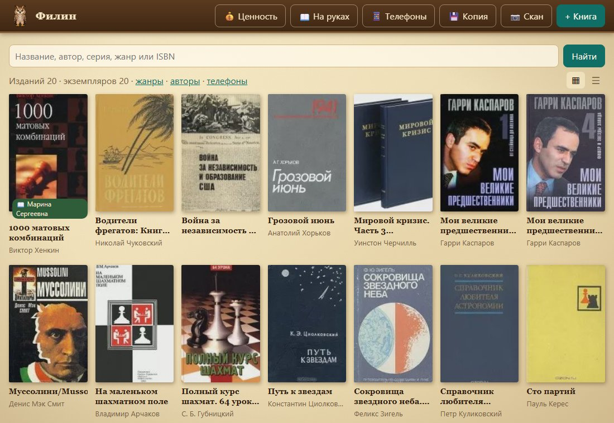

# Филин

**Каталог домашней бумажной библиотеки** — для тех, у кого дома тысячи книг: русских,
советских, дореволюционных, в том числе без ISBN. Книги заводят с телефона прямо у полки
(штрихкод, фото обложки, фото титула) или с компьютера.

Программа для Windows — один файл `filin.exe`: сервер, база SQLite и веб-интерфейс внутри,
приложение для Android раздаёт сама. Работает на домашнем компьютере, пока запущена;
данные никуда не уходят. **Как поставить — [пошагово, без командной строки](docs/установка.md).**

<p align="center"></p>

## Что умеет

- 📚 **Каталог плиткой, как полка на LiveLib**, или списком; поиск по названию, автору,
  переводчику, серии, жанру и ISBN без учёта регистра, «ё» и дореформенной орфографии
  («Повѣсти Бѣлкина» находятся по «повести белкина» и наоборот).
- 🖼️ **Обложки** — по желанию: фото с камеры телефона или файл. Снимок разворачивается
  по EXIF и уменьшается до 1200 px; у книги без обложки — «переплёт» с названием.
- 📷 **Сканер ISBN** камерой телефона. Если книга с таким номером уже есть — показывает её:
  издательства используют ISBN повторно, решает человек.
- 📖 **Издание и экземпляр — разные вещи.** Издание — что напечатано (авторы, переводчики,
  редакторы, издательство, год, том, ISBN). Экземпляр — что стоит на полке «комната →
  шкаф → полка»: состояние, экслибрис, автографы, история, «не давать почитать».
- 📇 **Карточка издания целиком**, как в выходных данных и у Лабиринта: авторы,
  переводчики, редакторы, художники, составители — отдельными полями; серия с номером;
  **жанры** (несколько); тип обложки, формат, страницы, тираж, цена на книге, бумага,
  иллюстрации, оформление, размеры и вес, типография, сведения об издании; оригинал и
  язык; аннотация и содержание сборника; ББК, УДК, авторский знак. Редкое свёрнуто.
- 👤 **Страницы людей**: все книги автора (переводчика, художника) по ролям и справка —
  годы жизни, пара строк, ссылка. Список авторов.
- 🏷️ **Жанры и серии**: отбор каталога по жанру, страница жанров по разделам, страница
  серии — что из неё есть, по номерам. Справочник жанров LiveLib загружается из
  сохранённой страницы.
- 🤝 **Выдача почитать.** У экземпляра «Дать почитать»: кому (имя строкой, с подсказками
  из прежних), когда, до какого срока. Метка на плитке, страница **«На руках»** —
  просроченные сверху, страница человека — что держит сейчас и что брал раньше;
  у экземпляра хранится история «кто брал». Пометка «не давать почитать» спрашивает
  подтверждение, но не запрещает.
- 💰 **Ценность — для себя.** У экземпляра: состояние по шкале букинистов alib.ru (плохое … идеальное, с пояснениями ступеней),
  отметка «❤️ дорожу» для памятного и собранного, оценка в рублях **с датой и основанием**
  («три предложения на alib.ru»), точной суммой или диапазоном «от – до». Оценки копятся,
  действует последняя. **Аналоги с alib.ru**: предложения букинистов, похожие на ваше
  издание (тот же год, то же издательство), — сверху; отмеченные галочкой заполняют
  оценку сами, сумму правите вы. Страница **«Ценность»**: сумма по библиотеке, сколько
  оценено, самое ценное, «дорожу» и комплекты — чего каждому не хватает и во что оценены.
- 📕 **Собрания сочинений**: заведите собрание («в 30 томах») — Филин покажет, какие тома
  есть и каких не хватает. Считаются книги, а не тома: том в двух книгах — два места,
  «Том 6-7» закрывает два. Книга ставится на место из своей карточки.
- 📱 **Приложение для Android**: сканер ISBN, фото обложки, «уже есть такая книга»,
  каталог целиком. Ставится и привязывается QR-кодами со страницы «Телефоны»,
  обновляется само.
- 🔄 **Обновляется сам** и на компьютере: узнаёт о новом выпуске на GitHub, спрашивает,
  сверяет сумму SHA-256 скачанного, перед заменой сохраняет копию библиотеки.
- 🏛️ **Карточка из РГБ** (каталог Российской государственной библиотеки): поиск по
  названию, автору или ISBN — на телефоне и на компьютере списком найденного, вы
  выбираете «Это она». Новая книга получает карточку целиком, у заведённой —
  **«Дополнить из РГБ»**: заполняются только пустые поля, расхождения показываются.
  Поиск идёт во встроенном браузере по вашему нажатию, как если бы вы искали сами:
  программам поиск РГБ закрыт (robots.txt), Филин читает только выбранную запись.
- 📖 **Книга без штрихкода** — по фото титула или каталожной карточки на обороте:
  распознавание [Tesseract](https://github.com/tesseract-ocr/tesseract) на компьютере → черновик карточки.
- 📚 **Аннотация с alib.ru** по кнопке: Филин сам находит страницу книги, показывает
  аннотацию и предложения букинистов с ценами.
- ✅ Отметка «прочитана» у экземпляра.
- 💾 **Резервная копия** кнопкой: база и все фото одним архивом; восстановление —
  перетащить архив на ярлык.
- 📥 **Импорт с LiveLib** из вручную сохранённых страниц полок — название, авторы и
  обложка (больше на плитке LiveLib нет).
- ⚠️ ISBN с неверной контрольной цифрой не выбрасывается, а хранится с пометкой —
  бывает и опечатка ввода, и брак печати.

## Запуск

Филин — одна программа `filin.exe`: сервер, база SQLite, страницы и картинки внутри.
Ничего ставить не нужно. Готовая сборка — в [выпусках](../../releases): `filin.exe`
и `filin.apk` для телефона.

1. Скачать `filin.exe` и положить в папку, где будет жить библиотека, например `D:\Филин\`.
   **Библиотека хранится рядом с программой**: база `filin.db` и фото в `covers\` появятся
   в той же папке. Перенести Филина на другой диск — перенести папку целиком.
2. Запустить двойным щелчком. Windows может предупредить «Windows защитила ваш компьютер»
   (у программы нет купленной цифровой подписи) — «Подробнее» → «Выполнить в любом случае».
   При первом запуске Windows спросит про доступ к сети — разрешить для частной сети,
   иначе телефон Филина не увидит.
3. Филин спросит: **«Создать ярлык Филина в меню „Пуск“ и на рабочем столе?»** — «Да».
   Дальше запускать ярлыком. Откроется каталог в браузере, в трее появится сова:
   «Открыть каталог», адрес для телефона, «Закрыть Филин».

Распознавание фото титула работает, если установлен [Tesseract](https://github.com/tesseract-ocr/tesseract)
с русским языком: Филин находит его сам в обычной папке установки. Без него всё остальное работает.

**Филин работает, пока он запущен.** Закрыли — сервер остановлен, телефон его не видит.
Второй запуск не поднимает второй сервер, а открывает каталог уже работающего.
Журнал — `filin.log` рядом с базой.

| Флаг | По умолчанию | Что задаёт |
|---|---|---|
| `-db` | `filin.db` рядом с программой | файл базы; схема создаётся и обновляется сама |
| `-port` | `8080` | порт программы |
| `-tesseract` | находится сам: PATH, `Program Files\Tesseract-OCR` | программа распознавания фото титула |
| `-updates` | последний выпуск этого репозитория | где узнавать о новых версиях; пусто — не проверять |

| Команда | Что делает |
|---|---|
| *(без команды)*, `app` | программа: сервер, браузер, сова в трее |
| `install`, `uninstall` | ярлыки «Филин» в «Пуске» и на рабочем столе; `uninstall` базу не трогает |
| `restore архив.zip` | восстановить библиотеку из резервной копии (Филин должен быть закрыт) |
| `stats`, `version` | счётчики базы, версия программы |
| `serve [-addr …]` | только сервер, без трея — для разработки |
| `import-livelib`, `import-livelib-genres` | импорт с LiveLib (ниже) |

### Резервная копия

Кнопка **💾 Копия** в шапке каталога (только на компьютере) скачивает `filin-ГГГГ-ММ-ДД.zip`:
снимок базы и все обложки и фото. Куда его положить — решаете вы: флешка, облако, другой
диск. **Восстановление** — закрыть Филина (сова → «Закрыть Филин») и перетащить архив
мышью на `filin.exe` или на ярлык «Филин»: Филин спросит и восстановит. То же из терминала:
`filin.exe restore filin-2026-11-06.zip`.

Нынешние данные не стираются, а откладываются в папку `до-восстановления-…` рядом с базой.

### Телефон

Приложение Android ставится с самого Филина: на телефоне открыть адрес из меню совы
(вида `http://192.168.1.10:8080`) и `/app.apk`. Привязка — кодом со страницы **Телефоны**
на компьютере. Из домашней сети Филин пускает только привязанные телефоны; привязка,
отзыв и резервная копия — только с компьютера. Филин слушает только домашнюю сеть
(ту, через которую компьютер выходит в интернет), сети VPN — нет.

## Импорт с LiveLib

LiveLib запрещает автоматический доступ к сайту, поэтому страницы полок сохраняются
руками: в Chrome открыть полку в режиме плитки → **Ctrl+S** → «Веб-страница, один файл»
(`.mhtml`). Потом:

```bash
./filin.exe import-livelib "Мои книги — стр. 1.mhtml" "Мои книги — стр. 2.mhtml"
```

Берётся название, авторы, ссылка на книгу и обложка — из самого файла, в интернет
импорт не ходит. Книга со значком «Мои книги» получает экземпляр без полки. Повторный
импорт той же страницы ничего не задваивает: книги узнаются по id LiveLib.

Справочник жанров LiveLib — так же, из сохранённой страницы `livelib.ru/genres`:

```bash
./filin.exe import-livelib-genres "Список жанров.mhtml"
```

Ограничения плитки LiveLib: издательства и года на ней нет; длинный список авторов
обрезан («Ещё 1») — такие имена не берутся, их нужно дописать в карточке руками.

## Разработка

Нужен Go 1.26 (как в `go.mod`), CGO не нужен.

```bash
go test ./...
go build -o filin.exe ./cmd/filin
```

Выпуск (`filin.exe` без окна консоли, с версией и приложением для телефона внутри) —
`pwsh release.ps1 -Version v1.0.0`, файлы — в `dist/`. Приложение для телефона собирается
`pwsh android/publish.ps1 -Data <папка библиотеки>` (нужен ключ подписи, см. скрипт).

| Пакет | Что внутри |
|---|---|
| `cmd/filin` | программа и команды (`app`, `serve`, `restore`, `install`…) |
| `internal/desktop` | Windows: сова в трее, ярлыки, адрес в домашней сети, один экземпляр, поиск РГБ встроенным браузером (WebView2) |
| `internal/update` | самообновление из выпусков GitHub: проверка, скачивание со сверкой SHA-256, замена работающего exe |
| `internal/bundled` | приложение для телефона, вшитое в выпуск |
| `internal/alib` | страница книги на alib.ru: аннотация, предложения с ценой и годом |
| `internal/backup` | резервная копия одним архивом и восстановление |
| `internal/rsl`, `internal/ocr` | карточка из записи РГБ; распознавание фото титула и каталожной карточки |
| `internal/web` | веб-приложение: обработчики, шаблоны `tmpl/`, статика `static/` (встроены в бинарь) |
| `internal/catalog` | издания, экземпляры, полки, собрания сочинений и комплектность, выдача, оценки, поиск |
| `internal/db` | открытие базы, миграции `migrations/NNNN_*.sql` (версия — `PRAGMA user_version`), функция `fold()` для поиска по кириллице |
| `internal/isbn` | разбор ISBN с проверкой контрольной цифры, ISBN-10 → 13 |
| `internal/cover` | обработка фото обложки (EXIF-разворот, уменьшение, JPEG) и каталог файлов обложек |
| `internal/livelib` | разбор сохранённых страниц полок LiveLib (`.mhtml`) и импорт |

Порядок работы: ветка → тесты → ревью → pull request.

## Документы

- [Как поставить Филина](docs/установка.md) — для человека, без командной строки: компьютер, телефон по QR-коду, копия.

Источники описаний — РГБ (карточка по записи), alib.ru (аннотация и цены) и импорт
LiveLib: схема хранит, откуда пришла запись (`source`, `source_url`, `livelib_id`),
а ручная правка происхождение не стирает.

## Лицензия

[MIT](LICENSE). Сторонние библиотеки — под своими лицензиями (см. `go.mod`, `android/app/build.gradle.kts`).
