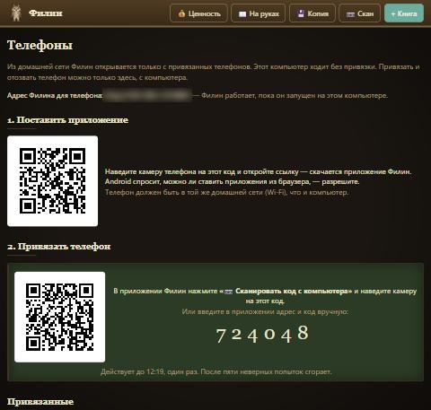

# Как поставить Филина

Филин — каталог домашней библиотеки. Он живёт на компьютере, а телефон — сканер и
вторая клавиатура: с него заводят книги прямо у полки. Работает, пока Филин запущен
на компьютере.

Понадобится: компьютер с Windows и телефон с Android **в одной домашней сети**
(один Wi-Fi-роутер).

## На компьютере

1. **Скачайте** `filin-setup.exe` со [страницы выпусков](../../../releases) — самый верхний выпуск.
2. **Запустите** его. Если Windows пишет «**Windows защитила ваш компьютер**» — нажмите
   «Подробнее», затем «Выполнить в любом случае». Так Windows встречает любую
   программу без купленной цифровой подписи. Прав администратора установка не просит.
3. **Папка.** Установщик предложит `C:\Users\<ваше имя>\Филин` — можно оставить. В этой
   папке будет и программа, и ваша библиотека (подпапка `библиотека`).
4. **Ярлык на рабочем столе** — галочка, по умолчанию включена. Ярлык в «Пуске» ставится всегда.
5. «Установить» → «Завершить» с галочкой «Запустить Филин». Если Windows спросит про
   **доступ к сети** — разрешите для частной сети, иначе телефон Филина не увидит.

Удалить Филина — «Параметры» → «Приложения» → «Филин». Установщик спросит, удалять ли
вместе с программой библиотеку; по умолчанию — нет, книги останутся.

Откроется каталог в браузере, а возле часов появится значок совы 🦉. Через него
Филин открывают снова и закрывают: «Закрыть Филин».

## На телефоне

В каталоге на компьютере нажмите вверху кнопку **«📱 Телефоны»**.

1. **Поставить приложение.** Наведите камеру телефона на первый QR-код и откройте
   ссылку. Скачается приложение Филин. Android спросит, можно ли ставить приложения
   из браузера, — разрешите и установите.
2. **Привязать телефон.** На компьютере нажмите «Привязать телефон — показать код» —
   появится второй QR-код. Откройте приложение Филин на телефоне, нажмите
   «📷 Сканировать код с компьютера» и наведите камеру на этот код. Всё — телефон
   привязан, откроется каталог.

Код привязки действует 10 минут и один раз. Не успели — покажите новый.

## Если что-то не так

| Что видно | Что сделать |
|---|---|
| На телефоне «Филин на компьютере не запущен» | Запустите Филина ярлыком на компьютере — телефон увидит его сам через несколько секунд. |
| Телефон не открывает ссылку из первого QR-кода | Телефон и компьютер в одной сети Wi-Fi? Разрешили Филину доступ к сети при первом запуске? |
| На странице «Телефоны» «Домашняя сеть не найдена» | Компьютер не подключён к роутеру — подключите и перезапустите Филина. |
| «Скачиваю модели распознавания: N из 27 МБ» | Это один раз после установки: Филин скачивает модели в фоне. Подождите и снимите титул снова. Если закрыть Филина, скачивание продолжится при следующем запуске. |
| «Распознавание не готово: …» | Модели не скачались (нет интернета или выпуск недоступен). Перезапустите Филина — он попробует снова, скачанное не пропадёт. Всё остальное работает и без распознавания. |

## Обновление

Филин сам узнаёт о новых версиях: через несколько секунд после запуска он заглядывает
на страницу выпусков и, если вышла новая версия, спрашивает, обновиться ли. Проверить
вручную: сова → «**Проверить обновления**».

Согласились — Филин скачает новую версию, сохранит в папке `копии` копию
`filin-перед-vX.Y.Z-ГГГГ-ММ-ДД.zip`, закроется и через несколько секунд откроется уже
обновлённым. Приложение на телефоне после этого предложит обновиться само. Отказались —
Филин спросит при следующем запуске.

Копий перед обновлением Филин хранит две последние, более старые удаляет сам. Архивы,
скачанные кнопкой «💾 Копия», он не трогает.

## Резервная копия

Кнопка **💾 Копия** вверху каталога скачивает архив `filin-ГГГГ-ММ-ДД.zip` — все книги
и фотографии. Положите его куда надёжнее: на флешку, в облако, на другой диск.

Восстановить: закройте Филина (сова → «Закрыть Филин») и **перетащите архив мышью на
ярлык Филина**. Филин спросит и восстановит; нынешние книги не удалятся, а будут
отложены в отдельную папку рядом.

## Перенести на другой компьютер или диск

Закройте Филина и перенесите папку целиком. На новом месте запустите `filin.exe`
двойным щелчком — он снова предложит ярлыки.
