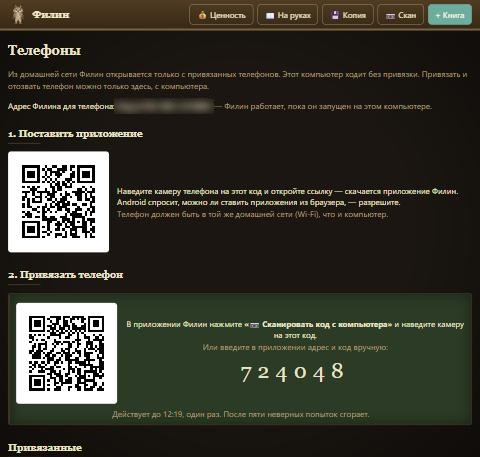

# Как поставить Филина

Филин — каталог домашней библиотеки. Он живёт на компьютере, а телефон — сканер и
вторая клавиатура: с него заводят книги прямо у полки. Работает, пока Филин запущен
на компьютере.

Понадобится: компьютер с Windows и телефон с Android **в одной домашней сети**
(один Wi-Fi-роутер).

## На компьютере

1. **Скачайте** `filin.exe` со [страницы выпусков](../../../releases) — самый верхний выпуск.
2. **Создайте папку** для библиотеки, например `D:\Филин`, и положите `filin.exe` туда.
   В этой же папке Филин будет хранить книги и фотографии. Не кладите его в
   `Program Files` — туда Windows не даёт записывать.
3. **Запустите** `filin.exe` двойным щелчком.
   - Если Windows пишет «**Windows защитила ваш компьютер**» — нажмите
     «Подробнее», затем «Выполнить в любом случае». Так Windows встречает любую
     программу без купленной цифровой подписи.
   - Если Windows спрашивает про **доступ к сети** — разрешите для частной сети.
     Иначе телефон Филина не увидит.
4. Филин спросит: «**Создать ярлык Филина в меню „Пуск“ и на рабочем столе?**» —
   нажмите «Да». Дальше запускайте Филина этим ярлыком.

Откроется каталог в браузере, а возле часов появится значок совы 🦉. Через него
Филин открывают снова и закрывают: «Закрыть Филин».

## На телефоне

В каталоге на компьютере нажмите вверху кнопку **«📱 Телефоны»**.

1. **Поставить приложение.** Наведите камеру телефона на первый QR-код и откройте
   ссылку. Скачается приложение Филин. Android спросит, можно ли ставить приложения
   из браузера, — разрешите и установите.
2. **Привязать телефон.** На компьютере нажмите «Привязать телефон — показать код» —
   появится второй QR-код. Откройте приложение Филин на телефоне, нажмите
   «📷 Сканировать код с компьютера» и наведите камеру на этот код. Всё — телефон
   привязан, откроется каталог.

Код привязки действует 10 минут и один раз. Не успели — покажите новый.

## Если что-то не так

| Что видно | Что сделать |
|---|---|
| На телефоне «Филин на компьютере не запущен» | Запустите Филина ярлыком на компьютере — телефон увидит его сам через несколько секунд. |
| Телефон не открывает ссылку из первого QR-кода | Телефон и компьютер в одной сети Wi-Fi? Разрешили Филину доступ к сети при первом запуске? |
| На странице «Телефоны» «Домашняя сеть не найдена» | Компьютер не подключён к роутеру — подключите и перезапустите Филина. |
| Распознавание фото титула недоступно | Нужна отдельная программа [Tesseract](https://github.com/tesseract-ocr/tesseract) с русским языком. Без неё всё остальное работает. |

## Резервная копия

Кнопка **💾 Копия** вверху каталога скачивает архив `filin-ГГГГ-ММ-ДД.zip` — все книги
и фотографии. Положите его куда надёжнее: на флешку, в облако, на другой диск.

Восстановить: закройте Филина (сова → «Закрыть Филин») и **перетащите архив мышью на
ярлык Филина**. Филин спросит и восстановит; нынешние книги не удалятся, а будут
отложены в отдельную папку рядом.

## Перенести на другой компьютер или диск

Закройте Филина и перенесите папку целиком. На новом месте запустите `filin.exe`
двойным щелчком — он снова предложит ярлыки.
